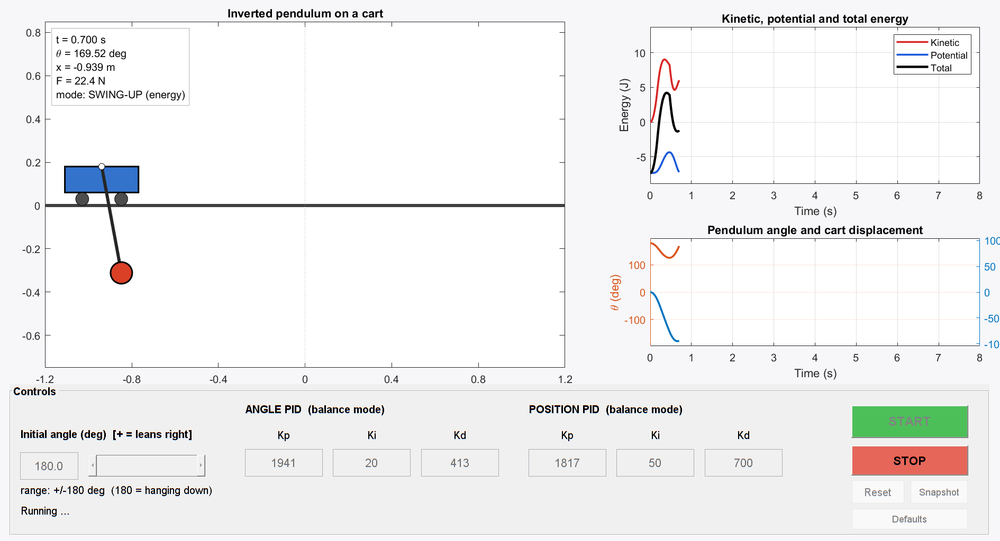
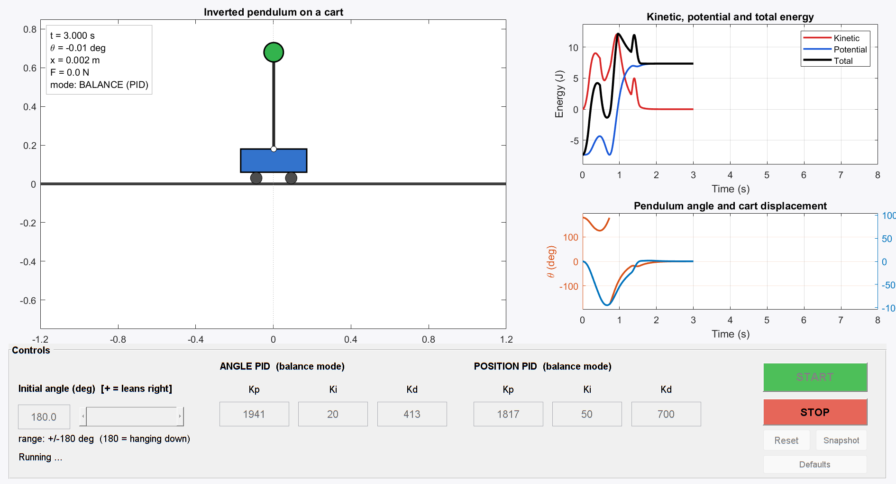

# Inverted Pendulum on a Cart: Swing-Up and Discrete PID Balance

A MATLAB GUI simulation of an inverted pendulum on a cart. From **any initial angle, including hanging straight down (180°)**, the cart swings the pendulum up and balances the bob above itself, then returns to its zero position.

| Swing-up phase (t = 0.70 s) | Balanced (t = 3.00 s) |
|:---:|:---:|
|  |  |

## Features

- Full **nonlinear** cart-pendulum dynamics (no small-angle approximation)
- **Energy-based swing-up** controller, active for large initial angles
- **Discrete PID** balance controller at 200 Hz (angle loop + cart-position loop)
- Automatic hand-over between swing-up and balance, with fallback if the pendulum falls
- Live animation of the whole system (bob colour shows the active mode)
- Kinetic, potential and total energy plotted in a single graph
- Editable initial angle (-180° to +180°) and all six PID gains from the GUI
- Snapshot button and batch mode for saving images

## System parameters

| Parameter | Value |
|---|---|
| Cart mass, M | 3 kg (moves horizontally only) |
| Bob mass, m | 1.5 kg |
| Rod | massless, L = 0.5 m |
| Sample time, Ts | 5 ms (200 Hz), zero-order hold |
| Force limit | ±1000 N |

## Requirements

- MATLAB R2019b or newer (developed and tested on R2024b)
- No additional toolboxes

## Usage

1. Download or clone this repository.
2. Open MATLAB, set the current folder to the repository folder.
3. Run:

   ```matlab
   invertedPendulumGUI
   ```

4. Set the initial angle (0° = upright, ±180° = hanging down, positive = leaning right), optionally change the PID gains, and press **START**.

Batch mode, for example to reproduce the images above:

```matlab
invertedPendulumGUI('InitialAngle',180,'AutoStart',true,'SnapshotTimes',[0.7 3.0])
```

Other options: `'SnapshotDir'`, `'Speed'`, `'CloseWhenDone'`.

## Method

**Dynamics** (θ measured from the upright vertical, F applied to the cart):

```
(M + m sin²θ) ẍ = F + m L θ̇² sinθ − m g sinθ cosθ
L θ̈ = g sinθ − ẍ cosθ
```

**Mode 1: swing-up (energy shaping).** With pendulum energy `Ep = ½ m L² θ̇² + m g L cosθ` and target `Ed = m g L`, the cart acceleration

```
a = k (Ep − Ed) · sign(θ̇ cosθ) − kx x − kv ẋ
```

pumps energy into the pendulum while the last two terms keep the cart near the centre of the track. It is converted into a force using the nonlinear model.

**Mode 2: balance (discrete PID).**

```
F[k] = PID_angle(θ[k]) + PID_position(x[k])
u    = Kp e + Ki Ts Σe + Kd (e[k] − e[k−1]) / Ts
```

Default gains:

| | Kp | Ki | Kd |
|---|---|---|---|
| Angle | 1941 | 20 | 413 |
| Position | 1817 | 50 | 700 |

The balance gains were derived from a pole-placement design on the linearised model (poles at −9, −10, −11, −12 s⁻¹), then checked and adjusted on the nonlinear simulation. The controller hands over when |θ| < 20.5°, |θ̇| < 8 rad/s and the pendulum energy is within 50 % of the upright value, and falls back to swing-up if |θ| exceeds 45°.

## Results

| Start angle | PID takes over | Pendulum within ±0.5° | Cart within ±2 cm of origin | Peak cart travel | Peak force |
|---:|---:|---:|---:|---:|---:|
| 15° | 0.00 s | 0.92 s | 0.58 s | 30 cm | 508 N |
| 20° | 0.00 s | 1.01 s | 0.46 s | 44 cm | 678 N |
| 90° | 3.79 s | 4.76 s | 4.20 s | 86 cm | 309 N |
| −135° | 2.69 s | 3.60 s | 3.03 s | 95 cm | 150 N |
| 180° | 1.31 s | 2.30 s | 1.50 s | 95 cm | 54 N |

A sweep from −180° to +180° in 10° steps balanced successfully in every case (worst case about 5 s, cart always within ±1 m).

## Limitations

- Balancing in about 1 s only holds for starts within roughly 20° of upright; larger starts need a few seconds to swing up.
- Swing-up parameters are tuned for this specific cart, rod and bob and for the displayed track range; re-tune if you change them.
- The track length is kept by a centring term, not by a hard physical limit.
- Ideal model and sensing: no noise, delay, friction or actuator dynamics.

## Repository structure

```
.
├── invertedPendulumGUI.m        GUI, controllers and simulation (single file)
├── images/                      screenshots used in this README
├── docs/implementation_notes.txt  detailed implementation notes
├── LICENSE
└── README.md
```

## Future work

- LQR controller and comparison with the PID design
- Sensor noise, measurement delay and friction
- Hard track limits
- Learning-based control

## Acknowledgements

This project was developed as a learning exercise in control and robotics with the assistance of Claude (Anthropic) for code and controller design. I ran, tested and tuned the simulation and reviewed the results.

## License

Released under the MIT License. See [LICENSE](LICENSE).
